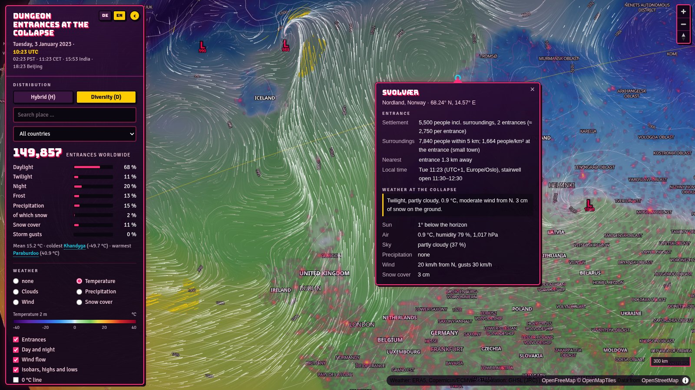
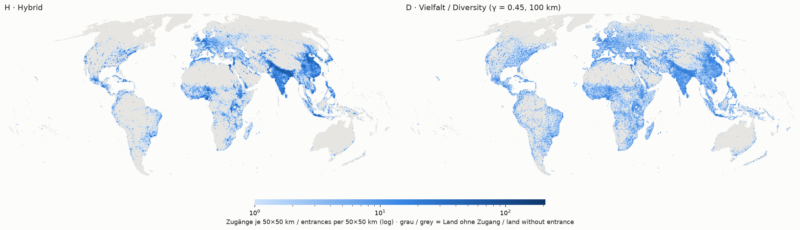

# DCC Entrance Map (deutsch)

*Wo öffneten sich die Treppenhäuser, und wie war das Wetter, als die Welt unterging?*

Eine inoffizielle Fan-Karte zu **Dungeon Crawler Carl**. Sie verteilt die 150.000 Dungeon-Zugänge aus den Büchern
nach echten Bevölkerungsdaten auf die echte Erde und zeigt das Wetter im Moment des Kollapses. Die Karte lässt sich als
Globus oder flach ansehen, die Zugänge in zwei Varianten verteilen, und ein Klick auf einen Zugang zeigt, wo er liegt,
wie viele Menschen dort lebten, wie spät es war und wie der Himmel aussah.

**Karte öffnen: <https://scumdivision.github.io/dcc_entrance_map/>** · auf Deutsch und Englisch ·
[English version](README.md)



## Funktionen

- **150.000 Zugänge** weltweit wie in den Büchern, verteilt nach dem Bevölkerungsraster GHSL 2025.
- **Zwei Verteilungen** zur Auswahl:
  - **Hybrid (H):** folgt der Bevölkerung eng. Megastädte bekommen Hunderte Zugänge.
  - **Vielfalt (D):** streut breiter, sodass Crawler ebenso gut aus Grönland, Alaska, von den Lofoten oder einem
    Pazifik-Atoll kommen können.
- **Wetter beim Kollaps** (3. Januar 2023, 10:23 UTC) aus der ERA5-Reanalyse: Temperatur, Bewölkung, Niederschlag nach
  Art (Regen, Schnee, gefrierender Regen, Schneeregen), Wind mit animierter Strömung, Schneedecke, Isobaren mit Hochs
  und Tiefs, 0-°C-Linie, Tag und Nacht mit Dämmerungszone.
- **Angaben je Zugang:** Region und Land, Einwohner der Siedlung mit Umland, Zahl der Zugänge dort und Menschen je
  Zugang, Einwohner im Umkreis von 5 km, Siedlungsart, Abstand zum nächsten Zugang, Ortszeit, Öffnungszeit der Treppe
  und eine kurze Wetterbeschreibung.
- **Suche** nach Ortsnamen (auch deutsche Namen wie *München*), **Länderfilter** mit Statistik (Anteil der Zugänge bei
  Tageslicht, Frost, Niederschlag, Schneedecke, kältester und wärmster Zugang) und das Wetter unter dem Mauszeiger an
  jeder Stelle der Karte.
- Dunkle, helle und Satelliten-Grundkarte.

## Kanon und Annahmen

- **Wann:** Buch 1 legt den Kollaps auf *Dienstag, 3. Januar, gegen 2:23 Uhr Pacific Standard Time*, also 10:23 UTC
  (11:23 MEZ). Ein Jahr nennen die Bücher nicht. Der 3. Januar war 2017 und 2023 ein Dienstag, spätere Hinweise
  sprechen für 2023, deshalb nimmt die Karte den **3. Januar 2023**.
- **Wie viele:** 150.000 Treppenhäuser, in besiedelten Gegenden, eher dort, wo sich Überlebende sammeln, und selten
  gleichmäßig verteilt. Sie öffnen wenige Minuten nach dem Kollaps und bleiben etwa eine Stunde offen (ungefähr 2:30 bis
  3:30 Uhr PST); das Popup rechnet das in Ortszeit um.
- **Wo genau**, steht nicht in den Büchern. Diese Karte ist eine plausible Antwort auf Grundlage echter
  Bevölkerungsdaten, kein Kanon.

## Die beiden Verteilungen

Beide gehen von denselben Daten aus: Siedlungen sind zusammenhängende besiedelte 1-km-Zellen (Siedlungsmodell der
GHSL), dazu die Bevölkerung im Umkreis von bis zu 25 km.

**Hybrid (H)** nimmt Siedlungen ab Kleinstadtgröße. Jede bekommt einen kleinen Sockel und einen Anteil nach
Einwohner<sup>0,85</sup>, die Zahl der Zugänge wächst also fast im Gleichschritt mit der Bevölkerung.

**Vielfalt (D)** arbeitet in zwei Schritten. Zuerst wird die Welt in flächengleiche Quadrate von 100 × 100 km geteilt,
und jedes Quadrat bekommt einen Anteil nach Einwohner<sup>0,45</sup>. Dann wird dieser Anteil auf die Siedlungen darin
verteilt, die jetzt schon ab Dorfgröße (1.000 Einwohner) zählen. Dichte Regionen bekommen weiterhin die meisten
Zugänge, aber deutlich weniger, als ihre Bevölkerung allein ergäbe, und abgelegene Orte bekommen eine echte Chance.

| | Hybrid (H) | Vielfalt (D) |
|---|---:|---:|
| Shanghai, Umkreis 50 km | 267 | 110 |
| Delhi, Umkreis 50 km | 306 | 104 |
| Tokio, Umkreis 50 km | 246 | 96 |
| Berlin, Umkreis 50 km | 59 | 48 |
| Grönland | 1 | 19 |
| Island | 6 | 41 |
| Alaska | 14 | 84 |
| Lofoten und Vesterålen | 1 | 10 |
| Pazifikinseln | 47 | 364 |
| Anteil China und Indien | 37 % | 21 % |



## Lokal starten

Am einfachsten ist die oben verlinkte Online-Fassung. Lokal genügt ein einfacher Webserver, weil alle erzeugten Daten
im Repository liegen:

```bash
git clone https://github.com/ScumDivision/dcc_entrance_map.git
cd dcc_entrance_map
python3 -m http.server 8790 --directory web
```

Dann <http://127.0.0.1:8790> öffnen. Grundkarten und Schriften kommen aus dem Internet.

## Daten neu erzeugen

Nur nötig, um die Verteilung oder den Wetterzeitpunkt zu ändern. Die Skripte nennen ihre Abhängigkeiten selbst und
laufen mit [uv](https://docs.astral.sh/uv/):

```bash
uv run dungeon_zugaenge.py   # Zugänge: lädt etwa 380 MB Quelldaten nach cache/, schreibt zugaenge/*.csv
uv run bauen.py              # Kartendaten: lädt ERA5-Felder (etwa 40 MB), schreibt web/daten/
```

Wichtige Optionen von `dungeon_zugaenge.py` (alle unter `--help`):

| Option | Bedeutung |
|---|---|
| `--vielfalt 0.45` | Exponent je Region in Vielfalt (D); 1 = proportional zur Bevölkerung, kleiner = breiter gestreut |
| `--d-zelle 100` | Größe der Regionen in km |
| `--d-schwelle 1000` | kleinste Siedlung (Einwohner mit Umland), die in D einen Zugang bekommen kann |
| `--seed 42` | Zufallsstartwert |

## Die Zugangsdaten

Die beiden CSV-Dateien in [`zugaenge/`](zugaenge/) enthalten eine Zeile je Zugang:

| Spalte | Bedeutung |
|---|---|
| `lat`, `lon` | Position (WGS 84) |
| `name` | größter benannter Ort der Siedlung; `bei X` = in der Nähe von X; `(namenlos)` = kein benannter Ort im Umkreis von 30 km |
| `cc` | Ländercode (ISO 3166-1 Alpha-2) |
| `region`, `region_en` | Bundesland oder Provinz (Natural Earth admin-1), deutscher und englischer Name |
| `siedlung_pop` | Einwohner der Siedlung mit Umland bis 25 km |
| `zugaenge_siedlung` | Zahl der Zugänge in dieser Siedlung |
| `umkreis_pop` | Einwohner im Quadrat von 9 × 9 km um den Zugang |
| `dichte` | Einwohner der 1-km-Zelle, in der der Zugang liegt |
| `klasse` | GHSL-Siedlungsklasse: 30 Stadtzentrum, 23 dichte Stadt, 22 Kleinstadt, 21 Vorort, 13 Dorf, 12/11 ländlich |
| `abstand_km` | Abstand zum nächsten anderen Zugang |

Die Daten dürfen gern für eigene Runden, Geschichten oder Karten genutzt werden; bitte die Quellenangaben unten
beibehalten.

## Bekannte Grenzen

- Ein Zugang landet an einer zufälligen Stelle innerhalb einer besiedelten 1-km-Zelle. Am Rand kleiner Orte kann er so
  einige Hundert Meter neben den Häusern liegen, auf einem Feld oder im Moor.
- Siedlungen ohne benannten Ort in der Nähe heißen `(namenlos)`. Das Popup zeigt trotzdem Region und Land.
- ERA5 hat eine Auflösung von etwa 28 km; Täler, Küsten und Stadtklima sind geglättet.
- Die Bevölkerungsdaten stammen von 2025, nicht 2023. Bei diesem Maßstab spielt das keine Rolle.

## Rückmeldungen

Ein Zugang an einer seltsamen Stelle oder eine Idee für die Karte? Gern als
[Issue](https://github.com/ScumDivision/dcc_entrance_map/issues).

## Quellen und Lizenzen

Siehe die Tabelle in der [englischen README](README.md#sources-and-licences): GHSL (JRC, CC BY 4.0), GeoNames
(CC BY 4.0), Natural Earth (gemeinfrei), ERA5 (Copernicus-Lizenz), OpenFreeMap/OpenMapTiles/OpenStreetMap, Esri,
MapLibre GL JS.

## Lizenz

Der Code (`dungeon_zugaenge.py`, `bauen.py`, `web/*.html|js|css`) steht unter der [MIT-Lizenz](LICENSE). Die erzeugten
Daten in `zugaenge/` und `web/daten/` stammen aus den genannten Quellen und behalten deren Bedingungen, vor allem die
Namensnennung für GHSL, GeoNames und Copernicus (CC BY 4.0 bzw. Copernicus-Lizenz).

## Hinweis

Inoffizielles Fanprojekt. Nicht verbunden mit Matt Dinniman oder den Verlagen von *Dungeon Crawler Carl* und nicht von
ihnen unterstützt. Alle Rechte an *Dungeon Crawler Carl* liegen bei ihren Inhabern.
