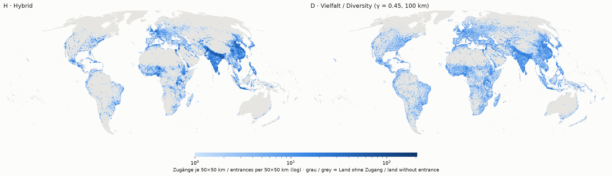

# DCC Entrance Map

**English** · [Deutsch](#deutsch)

An unofficial fan map for *Dungeon Crawler Carl*: 150,000 dungeon entrances spread over the real Earth, with the
weather at the moment of the collapse. Zoomable globe or flat map, two entrance distributions, a popup per entrance
with settlement, population, local time and weather, in English and German.



## What the map shows

- **The moment:** Book 1 places the collapse on *Tuesday, 3 January, around 2:23 AM PST* (10:23 UTC). The books never
  name the year; 3 January was a Tuesday in 2017 and 2023, and later hints point to 2023, so the map uses
  3 January 2023. The stairwells open a few minutes later for about an hour (≈ 2:30–3:30 AM PST).
- **150,000 entrances**, as in the books, placed on real population data (GHSL 2025, 1 km grid). Two distributions:
  - **Hybrid (H):** settlements from small-town size; every settlement gets a small base share plus
    population<sup>0.85</sup>. Big agglomerations get many entrances (Shanghai ±50 km: 267).
  - **Diversity (D):** first every 100 × 100 km region gets a share ~ population<sup>0.45</sup>, then that share is
    split among its settlements, down to village size. Agglomerations lose about 60 %, sparsely populated places gain:

    | | Hybrid (H) | Diversity (D) |
    |---|---:|---:|
    | Shanghai ±50 km | 267 | 110 |
    | Delhi ±50 km | 306 | 104 |
    | Tokyo ±50 km | 246 | 96 |
    | Greenland | 1 | 19 |
    | Alaska | 14 | 84 |
    | Lofoten/Vesterålen | 1 | 10 |
    | Iceland | 6 | 41 |
    | Pacific islands | 47 | 364 |
    | China + India | 37 % | 21 % |
- **Weather at 10:23 UTC** from the ERA5 reanalysis (ECMWF, 0.25° ≈ 28 km): temperature, clouds, precipitation by
  type (rain, snow, freezing rain, sleet), wind with animated flow, snow cover, isobars with highs and lows,
  0 °C line, day and night. Hover anywhere for the values under the cursor.
- **Per entrance:** region and country, settlement population incl. surroundings, number of entrances there and people
  per entrance, population within 5 km, density and settlement type at the entrance, distance to the nearest
  entrance, local time, opening hours of the stairwell, and the weather.
- Search (also finds German names like *München*), country filter with statistics (share in daylight, frost,
  precipitation, coldest and warmest entrance …).

## Run it

The built data is in the repository, so a static web server is enough:

```bash
python3 -m http.server 8790 --directory web
```

Then open <http://127.0.0.1:8790>. The base maps and fonts are loaded from the internet.

## Rebuild the data

Needs [uv](https://docs.astral.sh/uv/) (it installs the Python packages listed in the scripts).

```bash
uv run dungeon_zugaenge.py   # entrances: downloads ~380 MB of sources to cache/, writes zugaenge/*.csv
uv run bauen.py              # map data: downloads ERA5 fields (~40 MB), writes web/daten/
```

`dungeon_zugaenge.py --help` lists the knobs, e.g. `--vielfalt` (exponent of model D; 1 = proportional to population,
smaller values spread more), `--d-zelle` (region size in km), `--seed`.

### CSV columns (`zugaenge/dungeon_zugaenge_<H|D>.csv`)

`lat, lon` · `name` (largest GeoNames place of the settlement, “bei X” = near X, “(namenlos)” = unnamed) · `cc`
(country) · `region`, `region_en` (Natural Earth admin-1, German/English) · `siedlung_pop` (settlement incl. its
catchment up to 25 km) · `zugaenge_siedlung` (entrances in that settlement) · `umkreis_pop` (people in the 9 × 9 km
square around the entrance) · `dichte` (people in its 1 km cell) · `klasse` (GHSL settlement class: 30 urban centre,
23 dense town, 22 small town, 21 suburb, 13 village, 12/11 rural) · `abstand_km` (nearest other entrance).

## Known limitations

- Entrances are placed at random inside a populated 1 km cell. In small towns at the edge of open land, an entrance can
  end up a few hundred metres outside the houses.
- Settlements without a GeoNames place (≥ 1,000 inhabitants) within 30 km are called “(namenlos)” (unnamed); the popup
  still shows region and country.
- ERA5 is a 28 km grid: valleys, coasts and towns are smoothed.

## Sources and licences

| Data | Source | Licence |
|---|---|---|
| Population, settlement classes | [GHSL](https://human-settlement.emergency.copernicus.eu/) GHS-POP / GHS-SMOD 2025, European Commission JRC | CC BY 4.0 |
| Place names | [GeoNames](https://www.geonames.org/) cities1000 | CC BY 4.0 |
| Regions | [Natural Earth](https://www.naturalearthdata.com/) admin-1 | public domain |
| Weather | [ERA5](https://cds.climate.copernicus.eu/) via [ARCO-ERA5](https://github.com/google-research/arco-era5) | Copernicus licence: contains modified Copernicus Climate Change Service information (2023) |
| Base maps | [OpenFreeMap](https://openfreemap.org/), [OpenMapTiles](https://openmaptiles.org/), © [OpenStreetMap](https://www.openstreetmap.org/copyright) contributors; satellite imagery © Esri, Maxar, Earthstar Geographics | see providers |
| Map library | [MapLibre GL JS](https://maplibre.org/) | BSD-3-Clause |

The lore facts (date, time, number of stairwells, opening hour) come from *Dungeon Crawler Carl*, book 1, as collected
in the fan wiki.

**Unofficial fan project.** Not affiliated with or endorsed by Matt Dinniman or the publishers of *Dungeon Crawler
Carl*. All rights to *Dungeon Crawler Carl* belong to their owners.

---

## Deutsch

Eine inoffizielle Fan-Karte zu *Dungeon Crawler Carl*: 150.000 Dungeon-Zugänge auf der echten Erde, dazu das Wetter
im Moment des Kollapses. Zoombar als Globus oder flache Karte, zwei Verteilungen der Zugänge, ein Popup je Zugang mit
Siedlung, Bevölkerung, Ortszeit und Wetter, auf Deutsch und Englisch.

### Was die Karte zeigt

- **Der Zeitpunkt:** Buch 1 legt den Kollaps auf *Dienstag, 3. Januar, gegen 2:23 Uhr PST* (10:23 UTC, 11:23 MEZ).
  Ein Jahr nennen die Bücher nicht; der 3. Januar war 2017 und 2023 ein Dienstag, spätere Hinweise sprechen für 2023,
  also nimmt die Karte den 3. Januar 2023. Die Treppen öffnen wenige Minuten später für etwa eine Stunde
  (≈ 2:30–3:30 Uhr PST).
- **150.000 Zugänge** wie in den Büchern, verteilt nach echten Bevölkerungsdaten (GHSL 2025, 1-km-Raster). Zwei
  Verteilungen:
  - **Hybrid (H):** Siedlungen ab Kleinstadt; jede bekommt einen kleinen Sockel plus Einwohner<sup>0,85</sup>.
    Ballungsräume bekommen sehr viele Zugänge (Shanghai ±50 km: 267).
  - **Vielfalt (D):** Erst bekommt jede Region von 100 × 100 km einen Anteil ~ Einwohner<sup>0,45</sup>, dann wird er
    auf ihre Siedlungen verteilt, schon ab Dorfgröße. Ballungsräume verlieren etwa 60 %, dünn besiedelte Gegenden
    gewinnen (Zahlen in der Tabelle oben: Grönland 1 → 19, Alaska 14 → 84, Lofoten 1 → 10).
- **Wetter um 10:23 UTC** aus der ERA5-Reanalyse (ECMWF, 0,25° ≈ 28 km): Temperatur, Bewölkung, Niederschlag nach Art
  (Regen, Schnee, gefrierender Regen, Schneeregen), Wind mit animierter Strömung, Schneedecke, Isobaren mit Hochs und
  Tiefs, 0-°C-Linie, Tag und Nacht. Unter dem Mauszeiger stehen die Werte jeder Stelle.
- **Je Zugang:** Region und Land, Einwohner der Siedlung mit Umland, Zahl der Zugänge dort und Menschen je Zugang,
  Einwohner im Umkreis von 5 km, Dichte und Siedlungsart am Zugang, Abstand zum nächsten Zugang, Ortszeit,
  Öffnungszeit der Treppe und Wetter.
- Suche (findet auch deutsche Namen wie *München*), Länderfilter mit Statistik (Anteil bei Tageslicht, Frost,
  Niederschlag, kältester und wärmster Zugang …).

### Starten

Die fertigen Daten liegen im Repository, ein einfacher Webserver genügt:

```bash
python3 -m http.server 8790 --directory web
```

Dann <http://127.0.0.1:8790> öffnen. Grundkarten und Schriften kommen aus dem Internet.

### Daten neu erzeugen

Braucht [uv](https://docs.astral.sh/uv/) (installiert die in den Skripten genannten Python-Pakete).

```bash
uv run dungeon_zugaenge.py   # Zugänge: lädt ~380 MB Quellen nach cache/, schreibt zugaenge/*.csv
uv run bauen.py              # Kartendaten: lädt ERA5-Felder (~40 MB), schreibt web/daten/
```

`dungeon_zugaenge.py --help` zeigt die Stellschrauben, z. B. `--vielfalt` (Exponent von Modell D; 1 = proportional zur
Bevölkerung, kleinere Werte streuen breiter), `--d-zelle` (Regionsgröße in km), `--seed`.

Die CSV-Spalten, bekannten Grenzen sowie Quellen und Lizenzen stehen oben im englischen Teil.

**Inoffizielles Fanprojekt.** Nicht verbunden mit Matt Dinniman oder den Verlagen von *Dungeon Crawler Carl*. Alle
Rechte an *Dungeon Crawler Carl* liegen bei ihren Inhabern.
